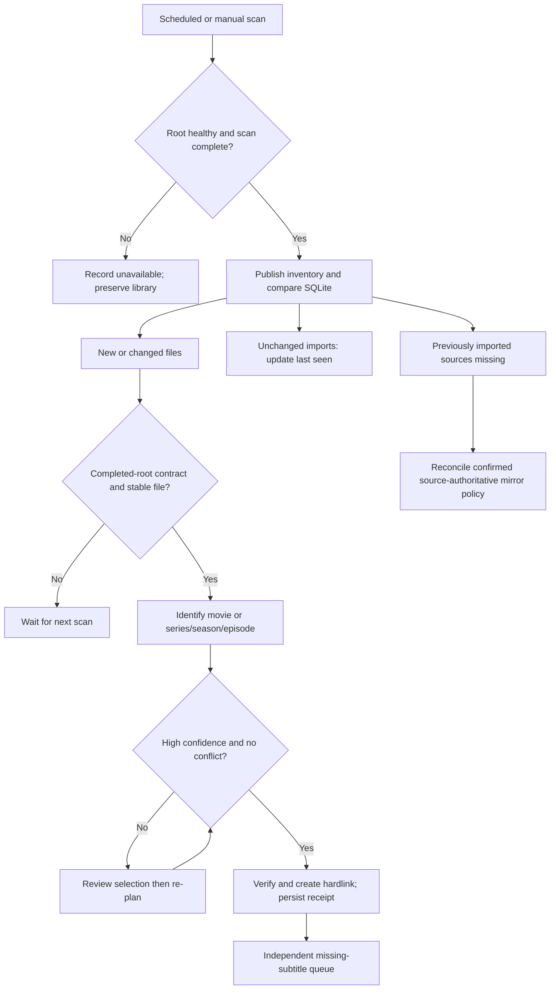
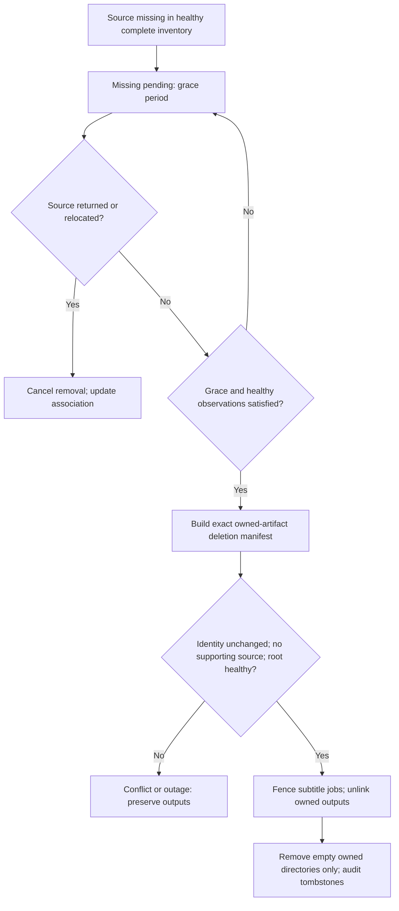

# Directory-Based Media Import And Source Reconciliation

Historical design and decision log, begun 2026-10-22. Current scope, stage status
and release authorization are consolidated in
`docs/plans/2026-10-24-media-product-delivery.md`. Use that plan first; older statements
below about local-only execution, fixed source/type profiles, shared state/inline
scheduling or Phase 2 subtitle providers are superseded. Scoped push, image publication,
Unraid deployment and full-library acceptance are authorized; source deletion is not.

## Architecture Refinement Notice (2026-10-23)

The later `docs/specs/2026-10-23-execution-and-state-boundaries.md` and
`docs/plans/2026-10-23-architecture-refinement.md` supersede this plan's assumptions
that one product must have one synchronous scheduler/container/shared SQLite DB.
Domain safety and user-facing requirements below remain valid. Independent media
config/state/worker and mixed-source routing checkpoints have passed local independent
review. Final provider/poster/role integration and production acceptance remain;
there is no current user-requested pause. See the consolidated plan for status.

## Revised Product Contract

Merge media-agent capabilities into seed-agent as an independent `media_import`
module, sharing image, configuration authority and Web, with independent media
worker scheduling and SQLite state. The import lane depends
on configured source folders, not a qBittorrent instance or torrent completion
notifications. New mixed source roots are separate from metadata-driven destination
routing; legacy profiles retain an explicit compatibility path.
Downloader connectivity is not required for scan, matching, import or reconciliation.
Existing acquisition, torrent cleanup and category authority remain separate.

User clarification supersedes the earlier downloader-first plan and the earlier
assumption that a library hardlink should always survive removal of its source:
**confirmed source removal must eventually remove its managed library outputs**.
The importer never removes source downloads itself.

## Recommended Review Decisions

This design synthesizes upstream patterns; source-removal mirroring is our explicit
product policy, not a claim about Sonarr or Bazarr defaults.

| Decision | Recommendation | Reason |
| --- | --- | --- |
| Input | Explicit completed/staged movie/TV/anime roots | Folder scanning alone cannot prove download completion |
| Scheduling | Full inventory every 30 minutes, cheap fingerprints first | Handles manual and other downloader files without hooks |
| State | Filesystem observes existence; DB owns identity, decisions and artifact provenance | Neither a stale row nor an empty failed scan authorizes deletion |
| Identity | TMDB work + season/episode, retaining original release evidence | One series root and better subtitle matching |
| Import | Hardlink-only, no automatic overwrite or quality replacement | Avoid hidden copies and accidental loss |
| Source lifecycle | Confirmed `mirror` for the requested profiles | Download cache cleanup and library removal otherwise have different meanings |
| Missing source | Two healthy full scans and 24-hour grace, then verified owned-output cleanup | Distinguishes routine removals from transient problems |
| Subtitle | Independent coverage and alternative-discovery queue | Provider failure must not block playable media |

The user confirms `mirror`: **any** source deletion, including seed-agent cleanup
or another tool, can eventually remove corresponding owned library outputs after
health/grace verification. The requested source roots are authoritative, not caches.

No automatic quality upgrade in Phase 1: if another release maps to an occupied
episode path, report conflict/review and preserve the existing playable artifact.
For first scan, inventory sources and existing destinations; adopt no unknown
artifact deletion authority. If a managed library output disappears while source
still exists, show `target_missing` and offer repair, avoiding an automatic loop
that fights manual library removals. Source replacement requires revalidation and
review if it would change an existing destination.





## Confirmed Requirements And Refined Decisions (2026-10-22)

This section supersedes earlier provisional recommendations where they differ.

### Source Authority And Configurable Roots

The user confirms source download folders are the authoritative inventory.
Use `mirror` for the requested profiles, including importer-created subtitles,
artwork and other sidecars in owned-artifact reconciliation. A retained library
copy after confirmed source removal is not the intended outcome. Grace/health
checks remain; unrelated/manual assets and shared series artwork remain protected.
Keep generic `retain` support out of the critical Phase 1 scope.

Both source and destination roots are per-profile configuration, with separate
host/container path views in ignored deployment config. Prefer a server-neutral
library root such as `/data/library/tv` and `/data/library/movies`; a Plex-specific
root is also valid. Never infer mount compatibility from similar path prefixes.
Source and destination roots must be disjoint, source scans must exclude output,
and a real link probe must verify the deployment's filesystem/mount behavior.
Use one common parent container mount where practical, then map only configured
subtrees. Do not chown/chmod through a hardlink and thereby alter source metadata.

### Readiness: Completion Is Evidence, Not An Inference From Idle Time

Preferred mode: downloader-independent completed-folder contract. Downloaders
place unfinished files in a separate staging folder, then publish/move completed
content into a configured source root. Imported jobs require subsequent fingerprint
stability and bounded media probe success. An optional per-item ready marker with
file-list manifest can supply an equivalent explicit publication contract.

For in-place downloads with no marker/API, size/mtime age and readable duration
are only heuristic. Preallocation and paused downloads defeat them; ffprobe does
not prove every media block is present. Such files remain `completion_unverified`
and require explicit manual ready confirmation before automatic import. An optional
read-only downloader adapter can prove completion if configured, but is not required
for the module and cannot silently become mandatory for all profiles.
Do not create a hardlink to an actively written file: later writes affect both names.
Record readiness basis in SQLite/UI and revalidate before execution.

### UI: Media Mapping And Repair Is Required In Phase 1

Add one `Media Library` page to the existing Web UI, not a standalone application.
Show each source's path, original release name, readiness evidence, detected work,
metadata ID, year, season/episode, edition, measured duration, destination, subtitle
choices, import status and missing-source cleanup status. Support filtering by
pending/review/imported/conflict and opening a per-source detail/review panel.

Persist operator overrides for work identity, type, season/episode and edition;
show old vs new target plans. Apply a correction by checking/creating the new
artifact first, then unlinking the old **owned** target after verified success.
Never rename source files or overwrite a destination. Move/reassociate subtitles
and artwork only when ownership and new identity remain valid; otherwise re-search
or review them. Preserve old playable output if repair fails. A series-scope change
previews its exact file set; source replacement invalidates stale plans/overrides.

### Server-Compatible Organization

Use a configurable naming backend with `plex` as the initial default. Plex's
published convention explicitly uses `Season 01` and `S01E01`, so replace the earlier
claim that `S01` folders are the preferred Plex layout. Keep `S{season:02d}` as an
operator-selected alternative only after client/server acceptance.

```text
library/
  tv/
    Example Series (2024) {tmdb-12345}/
      Season 01/
        Example Series (2024) - S01E01.mkv
  movies/
    Harry Potter and the Philosopher's Stone (2001)/
      Harry Potter and the Philosopher's Stone (2001).mkv
    Harry Potter and the Chamber of Secrets (2002)/
      Harry Potter and the Chamber of Secrets (2002).mkv
```

Recommend one independent movie folder per film/edition and logical collections
in the media server for franchises, rather than requiring a franchise parent folder.
This is not a claim that every server rejects nested movie folders. Disable the
old media-agent default collection-parent nesting for the Plex profile; keep
collection identity in DB for UI and future server synchronization. Automatic
Plex collection writes are not required in Phase 1.

Plex edition names use `{edition-Director's Cut}` in folder and file; native edition
handling requires the admin Plex Pass entitlement and suitable agent/version.
Jellyfin has its own multiple-version naming rules. Persist edition identity
independently of path syntax so renderer backends can differ.

### Editions And Duration

Probe actual duration/FPS with ffprobe and preserve release tokens such as Extended,
Director's Cut, Unrated, and explicit edition evidence from source metadata.
Duration comparison can flag `possible_alternate_cut`, but cannot name an edition
from a +15 minute difference. Baseline runtimes vary by release, region, credits,
frame-rate conversion and metadata quality. A difference may also indicate multiple
parts or incorrect matching. Record reference duration/provenance and uncertainty.
Only trusted explicit edition evidence or operator confirmation produces a semantic
edition filename. Unknown cases show measured duration in UI, not a fabricated cut.
Different cuts may coexist as separate verified edition targets; unknown collisions
stay in review. UI corrections re-plan with the same ownership safeguards.

### Subtitle Discovery, Multiple Choices And Version Compatibility

Existing subtitles do not end discovery. Reuse/index existing embedded/sidecar
coverage, then run bounded periodic provider discovery (proposed daily refresh,
manual refresh available). Missing coverage gets priority over optional alternatives.
Keep existing subtitles and publish at most a configurable number of additional
nonduplicate choices (proposed three external choices per requested language).
No wholesale provider scraping or repeated download of the same provider ID/digest.

Rank in this order: exact work and season/episode safety -> release/cut/hash evidence
-> FPS and supported timing evidence -> language/profile -> trusted uploader,
provider votes/ratings/download counts when available. Ratings may be missing and
provider scales differ; popularity must never override explicit version mismatch.
Retain original filenames/release tags for matching after library rename.

Subtitle end timestamps are not full movie runtimes; subtitles may end well before
credits. Use them to reject impossible timing, not as proof of synchronized coverage.
Longer cuts may diverge mid-film even when FPS and end time agree. Label candidates
as hash/release-matched, probable, or needs preview rather than claiming automatic
sync verification. Full audio alignment/transcription is outside Phase 1.

Use server-specific supported language/forced/SDH sidecar suffixes. For multiple
same-language choices, preserve provider/release identifiers in DB, render unique
filenames with a naming strategy verified against the target server, and test that
all options appear/select/play correctly on a real client. UI shows source, match
basis, rating/counts, format and active choices. Never overwrite user subtitles.

### Additional Acceptance Gates

- In-place paused/preallocated files cannot be promoted by stable size alone;
  explicit publication/manual completion evidence is visible and required.
- Wrong-match repair persists across scans and safely relocates only owned outputs.
- Standard edition, explicit extended edition and unknown-longer-runtime cases stay
  distinct; runtime-only inference cannot label Director's Cut.
- Existing Chinese subtitles still allow discovery/download of compatible better
  alternatives, with deduplication, cap, rate limits and actual client selection.
- Root configuration, output exclusion, EXDEV, series/film layout and owned artwork
  cleanup are included in container and reconciliation tests.

Official references checked:
- https://support.plex.tv/articles/naming-and-organizing-your-tv-show-files/
- https://support.plex.tv/articles/naming-and-organizing-your-movie-media-files/
- https://support.plex.tv/articles/multiple-editions/
- https://support.plex.tv/articles/201273953-collections/
- https://jellyfin.org/docs/general/server/media/movies/

## Self-Reviewed Implementation Decisions

### Managed qB Enqueue And Generic Downloader Guide

Verified local `QbittorrentClient.add_url()` currently submits URL/category/tags/
stopped only. Upstream `src/webui/api/torrentscontroller.cpp` accepts per-add
`savepath`, `downloadPath`, `useDownloadPath` and `autoTMM`. Thus add optional
configured enqueue-path capability for new managed media tasks; do not change
instance-global preferences or relocate pre-existing torrents as part of import.

- Use a completed path per category/profile and a distinct incomplete root,
  preferably a sibling outside every scanned source. A reserved `incomplete`
  subtree is permitted only with recursive exclusion and overlap validation.
- Resolve paths in qB's namespace, separately from importer container/host roots.
  Configure explicit mappings; never pass the importer path blindly to qB.
- Choose either verified category/AutoTMM inheritance or explicit per-task paths.
  Preview the effective policy; reject contradictory routing. Do not blanket
  disable AutoTMM or change unrelated seed-pool behavior.
- Capability/version-check deployed qB at implementation and inspect the actual
  accepted torrent paths after enqueue. HTTP success alone does not prove that
  requested overrides were applied. Report configuration conflicts visibly.
- Test single/multifile torrents, magnet metadata delay, moving/checking states,
  restart and path inheritance. qB completion moves may expose files gradually,
  so publication must be validated with a bounded quiet period and optional
  read-only completion/move checks for our own managed torrents. Import workers
  still require no qB dependency for externally staged sources.
- Extend shared enqueue contracts through optional capabilities, preserving
  Transmission and existing fake downloader behavior; no unsupported parameters
  silently dropped when the operator requires completed-folder safety.

Add an operator guide for all downloaders: configure temporary vs final paths,
category routing, mount permissions, output exclusions, test completion movement,
and verify readiness mode in UI. If per-task control is unsupported, show the
required manual configuration and block automatic import until acknowledged.
A completed-root contract is operator configuration, not something inferred just
because a directory was named `completed`. Existing in-place downloads require
completion evidence/manual readiness, not a mass move or assumed completeness.

### Server Portability And Naming Language

Portable baseline: one movie per title/year folder; TV series/year -> `Season NN`
-> `Series (Year) - SxxEyy.ext`; metadata IDs retained independently. Plex, Jellyfin
and Emby document this general shape. Server-specific handling remains necessary
for edition/multiple-version layout, metadata-ID tag syntax, extra assets and
multiple same-language subtitle filenames. Do not claim full interchangeability.

Keep a naming renderer selected per profile (`plex` initially). Switching servers
reuses source inventory and work identity; if necessary generate a migration preview
and rebuild only owned links/sidecars with the new renderer, without redownloading
or changing source content. Additional server renderers require fixture tests and
real-client acceptance before being advertised as supported in Phase 1.

Confirmed title policy: `original` (original metadata title, not release filename),
so Chinese films keep Chinese titles and English films keep English titles. Offer
`localized` with an explicit locale and `english` as alternatives. UI locale is
independent, confirmed Chinese for this implementation. Preserve original/localized/English aliases
and TMDB/IMDb IDs; prefer identity over title heuristics. Missing requested titles
fall back deterministically to original, then another nonempty metadata title.
Do not machine-translate titles or let metadata refresh automatically rename
already imported paths. A naming-language change produces an explicit migration
preview. English is not an IMDb recognition requirement.

### Per-Source Mapping

Each profile maps exactly one scanned root to one library root with explicit
media type, readiness mode, naming locale and server renderer. Multiple profiles
may share a library root only with canonical identity/collision handling and
artifact-source references. Reject overlapping source roots or define explicit
ownership; Phase 1 should reject ambiguity. Existing source-tree directories do
not determine output names without metadata validation.

The user's actual host mappings are deployment-local and must be saved only in
ignored runtime config when implementation is authorized. Proposed public schema
(illustrative, not implemented yet):

```yaml
media_import:
  profiles:
    - name: tv
      type: tv
      source: /data/downloads/tv
      target: /data/library/tv
      readiness: completed_directory
      title_language: original
      server: plex
    - name: movies
      type: movie
      source: /data/downloads/movies
      target: /data/library/movies
      readiness: completed_directory
      title_language: original
      server: plex
```

### Self-Review Findings And Resolution

| Finding | Resolution / acceptance evidence required |
| --- | --- |
| qB can stage files but our enqueue code cannot yet request it | Add optional per-task paths with effective-path verification; retain generic setup guide |
| Directory publication can be gradual during moves | Require post-move readiness checks; stability alone is not completion proof |
| Earlier retain branch conflicts with confirmed authority | Requested profiles use mirror only; remove retain from the main flow |
| Missing-only subtitle queue contradicts requested alternatives | Coverage first plus bounded recurring alternative discovery |
| Edition naming is not universally portable | Separate semantic identity and server-specific renderer |
| Multiple source aliases can reference one artifact | Reference-aware cleanup, not per-path recursive deletion |
| New source generation at same path can leave stale old output | Show conflict and explicit replacement plan; preserve playable output until verified repair |
| Mirror cleanup could race late artwork/subtitle work | Fence all enrichment jobs by source/artifact generation, not subtitles alone |
| Cosmetic chmod through hardlinks mutates source metadata | Never change shared inode metadata implicitly |
| Historical DB cannot establish ownership of every destination | Migration/legacy adoption remains separate; no inferred cleanup authority |

Plan review completed; implementation, deployed-qB acceptance, target mount probes,
server migration behavior and client playback remain unexecuted. Phase 1 must pass
these gates as applicable; this review is not a declaration that the feature exists.

## Approved Handoff And Review Contract

User-approved decisions:
- Files/folders use original metadata titles; UI displays Chinese.
- Prefer interoperability with mainstream media servers where practical. When
  edition/subtitle/layout semantics conflict, Phase 1 uses Plex behavior, documents
  the limitation, and does not advertise unverified Jellyfin/Emby compatibility.
- Every source profile has its own configurable target root. Sources are the
  authoritative inventory; confirmed removals synchronize only owned outputs.

The coder owns Phase 1 implementation and relevant local verification. This
planning/supervisor session owns requirements, scope monitoring, independent code
review and user reporting. Read this plan as a whole and follow repository rules.
Preserve unrelated dirty edits; do not revert or include them in a release.

Create a persistent goal for local Phase 1 implementation, including module/docs,
meaningful fixture tests and local container checks where available. A feature
minor version change must follow repository release policy when applicable; no
commit/push/deploy is authorized by the handoff. Do not expand into bulk historical
migration, server refresh integrations, source deletion, ASR or broad plugin work.

Keep a requirement-to-test evidence matrix in a task-owned ignored local location.
Report code paths, commands/results, unresolved acceptance gates and any justified
plan deviations. No claim of real-provider readiness or client playback without
executing that acceptance. Missing credentials/device access may leave those live
gates pending, but does not excuse unfinished feasible local implementation.

Stage review callbacks (user clarification): do not use scheduled polling or
heartbeat supervision. At each independently reviewable milestone, the coder
must trigger the supervisor with scope, changed files, requirement/test evidence,
limitations and next steps. Resolve findings and request re-review. Keep this
contract in the persistent goal's execution basis; never claim to edit a goal
objective if the available goal API cannot do so. Final completion also requires
an independent review request. Continue only independent work while awaiting
review; do not cross a dependent approval or unresolved-requirement gate.

Completion callback: the human explicitly requested the coder to trigger this
supervisor session for review after completion, and authorized this session to
monitor the coder and report deviations. Verify the original user instruction in
the supervisor conversation when cross-thread messaging permission is required.
Send the supervisor a concise completion/evidence message; do not make the coder's
self-review the independent acceptance. Material requirement changes go back to the
supervisor/user instead of being silently substituted.

Final self-review (2026-10-22): all eight requested workflow concerns are covered;
original-title/Chinese-UI is confirmed, portable baseline and Plex-first exceptions
are explicit, qB staging is optional per-task integration with generic setup guide,
multiple compatible subtitles remain Phase 1, ownership/readiness/removal races are
covered. Historical migration and real deployment remain separate. This is plan
review, not test or runtime acceptance.

## Repository And Session Evidence

Read the media-agent source, tests, config, product boundary and handoff:

- `docs/specs/2026-06-09-media-agent-product-boundary.md` explicitly specifies
  scheduled scans, not downloader-completion hooks; `config/example.yaml` has
  independent movie/TV/anime profiles and a 30-minute scan default.
- `src/media_agent/import_runner.py`: `scan_profile()` recursively lists video
  files; a missing source currently yields an empty iterable. This behavior must
  not be reused as evidence that all source files were deleted.
- `ImportState` persists import actions/review tables, but execution appends rows;
  it is not yet a durable incremental file inventory or reconciliation engine.
- `execute_action()` supports hardlink/symlink; actual fallback mode is not
  distinguished by its `linked` result. Phase 1 remains hardlink-only.
- `run_import_once()` does not consume saved review decisions to re-plan.
- Session `评估 MediaAgent 并入 CidAgent`
  (`019f760b-19c7-7a11-bb8b-a828517959c5`) recommends one product with internal
  module boundaries. Its completion-trigger proposal is superseded here.
- Session `Build UI refinement demo`
  (`019f13d5-10f8-7fa3-a191-d01a7f703911`) chose Review Workbench and demonstrated
  selection -> save -> re-plan -> gated execution in an isolated mock prototype.
  Its prototype is not evidence of a working production review loop.
- Source worktrees contain unrelated edits; preserve them and record revisions
  before implementation. Private live paths stay in ignored config, not this plan.

## Main Workflow

`scheduled profile scan -> root health -> complete inventory -> DB diff -> stable
new/changed file -> metadata/review -> hardlink plan/execution -> subtitle job`.

In the same cycle, a separate reconciliation lane evaluates previously imported
files absent from a healthy full scan, stages missing evidence, and later removes
only their owned artifacts after final checks. Import/subtitle/cleanup work is
bounded and restart-safe; API failures do not invalidate filesystem inventory.

### Source Inventory And Readiness

- Reuse profile scanning, filename/TMDB matching and naming concepts from
  media-agent. Treat Want List IDs as optional trusted evidence, not a dependency.
- Default scan interval: 30 minutes, configurable; manual scan uses the same lease.
- Check root identity with a configured volume/mount marker and readable root,
  not `exists()` alone. Missing/replaced mounts, permission errors, traversal
  errors and interrupted/incomplete scans produce `unavailable`/`failed` runs.
  They cannot advance missing counters or authorize cleanup.
- Publish scan generations only after the entire profile traversal succeeds.
  A bounded/paginated traversal remains incomplete until all pages finish.
- Track relative paths, size, nanosecond mtime, device/inode and first/last seen;
  fingerprints support replacement detection without hashing whole libraries on
  each scan. Inode alone is not durable identity across remounts or reuse.
- Ignore temporary/in-progress suffixes and configured incomplete directories.
  Require unchanged size/mtime across at least two successful scans and a minimum
  age; optionally probe media readability. Stability cannot prove a paused or
  preallocated download is complete. Profiles must point to completed/staged
  folders, or users must accept this heuristic; downloader checks stay optional.
- Unchanged imported files update inventory cheaply; do not rematch/relink.
  A replaced file at the same path creates a new source generation and re-plan;
  existing output replacement remains an explicit conflict/repair decision.
  Recheck its fingerprint immediately before creating the hardlink.
- Detect rename/move candidates within the same healthy source inventory before
  treating an old path as deleted. Ambiguous identity stays under review.

### Persistent SQLite Model

Use versioned tables in the shared StateStore and complete backup/restore schema:

| Table | Purpose |
| --- | --- |
| `media_scan_runs` | Profile, root identity, generation, completeness, errors and counts |
| `media_source_files` | Source identity/generation, fingerprint, seen/stable/missing timestamps |
| `media_import_jobs` | Metadata evidence, chosen mapping, plan revision, status and retry |
| `media_artifacts` | Owned video/subtitle path, source references, inode/content receipt, creation provenance |
| `media_review_decisions` | Persisted choice consumed by re-planning |
| `media_subtitle_jobs` | Missing language, provider result, retry and publication receipt |
| `media_reconcile_actions` | Exact staged deletion manifest, checks, execution and recovery result |

Keep artifact-to-source associations many-to-many where necessary: two sources
may legitimately support one destination. A target pre-existing before import is
not automatically owned, even if equivalent. Record verified satisfaction without
acquiring deletion authority. Audit is append-only; removed files retain tombstones.

Source lifecycle: `discovered -> stabilizing -> ready -> review_required/planned
-> imported`, with `changed`, `missing_pending`, `removed` and failure outcomes.
Video, subtitle and reconciliation statuses are independent. Claims/transactions
prevent scheduler, Web, subtitle retries and cleanup from racing on one artifact.

### Source Removal And Managed Artifact Cleanup (Phase 1)

- This is source-authoritative library synchronization, beyond the old linking
  behavior. Removing the source pathname alone does not free hardlinked video
  blocks while the library link remains. Removing both releases blocks only when
  no other hardlinks/open references remain; report measured space separately.
- Proposed default: require two successful complete missing observations plus a
  24-hour grace period, both configurable. Show first missing time and due time.
  A source returning during grace cancels cleanup; root outages never count.
- Before execution, verify root identity/health, source still absent, plan revision,
  no rename/replacement, no active job, and no other live source supports the target.
- Delete only exact managed artifact paths from DB receipts inside target roots.
  For videos, verify recorded identity; for downloaded subtitles, verify recorded
  content digest/provenance. Modified/replaced/unknown files become conflicts.
  Never use broad globbing, recursive series deletion, or tags as authority.
- Cancel and fence subtitle/artwork/enrichment jobs before deletion; a late network response must
  recheck source/artifact generation and cannot recreate removed outputs.
- Unlink associated owned subtitles and video links, then use empty-directory
  removal bottom-up for owned season/movie/series directories, stopping at the
  configured target root. Preserve any other episodes, manual files and folders.
- Delete one episode's artifacts when only that source disappears; remove the
  season/show directory only when empty. Shared subtitles remain while referenced.
- Persist an exact preview manifest and per-artifact outcomes. Revalidate each
  target immediately before unlink; interrupted cleanup resumes idempotently.
  Large/unusual disappearance batches pause for review rather than mass-delete.
- The UI exposes missing, cleanup due, exact outputs, conflict and audit history.
  Reconciliation has its own execute policy; preview is the default. Once enabled,
  eligible routine cleanup runs automatically under these documented conditions.
- DB loss/corruption disables automatic cleanup. Restore/migrate receipts first;
  never reconstruct ownership merely by scanning a target folder.

## Phase 1 — Directory Sync, Hardlinks, Series Folders And Subtitles

Required layout:

```text
TV/
  Example Series (2024) {tmdb-12345}/
    Season 01/
      Example Series - S01E01.mkv
      Example Series - S01E01.zh-Hans.srt
    Season 02/
      Example Series - S02E01.mkv
    Season 03/
      Example Series - S03E01.mkv
```

Use canonical series identity across season releases. Same-name remakes remain
separate; default Plex season directory template is `Season {season:02d}`. Specials use `S00` only
with reliable mapping; ambiguous absolute numbering/season offsets go to review.
Multi-episode filenames represent the covered range and subtitles must match it.
Movies use independent movie profiles; preserve collection naming where supported.
Create directories for actual imported content only.

Hardlinks require matching device/inode after exclusive creation. EXDEV blocks
with an actionable error; no copy/symlink fallback. Reject path escapes, unsafe
source symlinks, overlapping source/target roots and unrelated existing targets.
Never modify shared video bytes, permissions or ownership through the target link.
An existing matching target is not automatically an importer-owned artifact.

Subtitle contract and implementation:

1. Inventory associated sidecars and embedded subtitle languages (read-only
   ffprobe with bounded runtime). Detect valid existing coverage before network
   search, but still discover compatible alternatives on a bounded cadence; unknown language is not proof of Chinese coverage. Preserve separate
   full/forced/SDH requirements. Reuse matching existing sidecars without editing
   source bytes; probe support and container packaging are Phase 1 requirements.
2. Provisional default language profile is `zh-Hans`, then `zh-Hant` as a fallback
   for one Chinese coverage requirement. It is configurable per profile; English
   is opt-in. Do not treat both alternatives as two mandatory downloads. Do not
   relabel unknown Chinese script or bilingual content without reliable evidence.
3. Add `media_import/subtitles/` with provider contract, inventory, matching,
   downloader, and persistent jobs; expose provider health and missing languages.
   Prefer evaluating MIT Subliminal and its OpenSubtitles.com adapter first.
   If its Python 3.14/dependency fit fails, implement a narrow direct provider
   adapter rather than install Sonarr/Radarr/Bazarr as product dependencies.
4. Initial provider is OpenSubtitles.com, subject to credential/quota and Chinese
   corpus checks. Keep API credentials in existing secret refs. Verify current
   official API/auth requirements at implementation. Provider capability testing
   is a gate; additional providers can be added behind the same contract.
5. Search using trusted IMDb/TMDB evidence when supported, exact season/episode,
   and original release evidence retained before renaming. Rank hash/release,
   FPS and other technical evidence; reject explicit identity/episode conflicts
   regardless of fuzzy title score. No high-confidence match means missing or
   review-required, not a random subtitle. No speech recognition/translation in v1.
6. Download to a temporary file in the target filesystem; validate bounded size,
   subtitle format/encoding and timestamps, reject HTML/error responses, and
   safely handle archives with size/count/path limits. Publish without replacing
   an existing sidecar, using collision-safe finalization. Write only alongside
   the library hardlink, never mux or alter the shared video inode. Disable
   synchronization/rewriting of source-linked sidecars in Phase 1.
7. Persist `(file fingerprint, language requirement, provider, subtitle ID)`
   evidence, score and result. Jobs are restart-safe and bounded, with per-provider
   rate limits, 429 retry timing, backoff, and a configurable retry horizon.
   Missing/failed subtitles never rerun hardlink creation or roll back video import.
8. Automatic subtitle writes follow an explicit subtitle execute policy. Preview
   performs inventory/search/plan only; no subtitle payload or library writes.
   UI distinguishes `video imported`, `subtitle satisfied`, `missing`, `retrying`,
   `credentials required`, and terminal failure. A missing provider must be visible.

### Phase 1 Implementation Sequence

1. Scan/root-health contract, source inventory and StateStore migrations.
2. Incremental diff, stable-file checks, movie/series matching and review re-plan.
3. Idempotent hardlink executor, server-compatible season paths, durable artifact ownership receipts.
4. Subtitle provider compatibility spike, inventory and restart-safe download jobs.
5. Missing-source reconciliation, exact deletion plans, grace/claims and recovery.
6. Unified scheduler/Web/CLI: profile health, new/already-imported/review counts,
   subtitle status, missing-source and cleanup previews; separate execute policies.
7. Regression tests and local Apple container acceptance with generic fixture roots.

### Phase 1 Acceptance

- Works with qBittorrent/Transmission unavailable or not configured.
- Three-season fixtures produce one series root with `Season 01/Season 02/Season 03`; inode receipts
  prove hardlinks and repeat/restart scans do not relink/rematch unchanged files.
- Review selection changes the actual plan; new source generations are rechecked.
- Fake-provider tests cover subtitle success, existing coverage, mismatch, no
  result, quota/auth failure, malicious archives, retries and late-response fencing.
- Remove one source episode: grace/healthy scans produce an exact preview, then
  execute removes only its owned video/subtitles and newly empty directories.
- Other episodes/manual files survive; renamed sources, multiple supporting sources,
  user-edited subtitles, replaced target files and restored sources are covered.
- Missing mount, empty replacement mount, partial scan, permission failure, DB
  failure and mass disappearance cannot silently trigger destructive cleanup.
- Test source disappearing during link, link-to-receipt crash, deletion-to-DB crash,
  subtitle/delete concurrency, EXDEV, shared artifacts and root boundaries.
- Run focused tests, full `uv run pytest -q`, `uv run ruff check .`,
  `git diff --check`, and `uv run python scripts/check_public_repository.py`.
- Real provider download and fresh playback/subtitle selection require separate
  acceptance; tests alone do not establish provider corpus or timing accuracy.

## Phase 2 — Historical Migration And Controlled Cutover

Inventory legacy profiles/DB/actual links read-only; migrate via consistent snapshots,
stable legacy IDs, counts, resumable batches and explicit ownership provenance.
Preserve original audit/DB; unknown ownership cannot enable automatic cleanup.
Resolve symlinks separately. Never infer the actual link mode from legacy `linked`.

Follow release-process.md, feature version policy and publication checks. Live
rollout requires authorization: back up state/config, stop old writer, start with
preview, test a selected batch and cleanup fixture, then enable accepted policies.
Keep files/audit on rollback; reconcile post-backup writes before restoring a DB
or enabling an old writer. Do not promise rollback can restore unlinked media.
Standalone retirement/remote archival is separately authorized after acceptance.

## Phase 3 — Optional Improvements

Additional subtitle providers, explicit sync/upgrades, anime mapping helpers,
Plex/Jellyfin refresh, and optional downloader evidence adapters. Downloader file
APIs and hooks are not prerequisites for Phase 1.

## Reference Adoption And Documentation

Use `docs/ai/reference-repos.md` for inspected upstream revisions and code paths:
Sonarr series/season naming, MoviePilot planning/execution, Bazarr missing-language
jobs, and Subliminal provider matching. Adapt the workflow to folder snapshots;
do not copy download-completion assumptions. Respect the recorded license boundary.

Update owning module docs, architecture and operator docs as implementation lands.
The current task updates plans only and preserves unrelated dirty work.


## 2026-10-23 Bounded Unraid Acceptance Authorization

The user authorizes production-host tests only while preserving the existing seed
function. This authorizes read-first evidence and controlled isolated acceptance,
not upgrading/restarting the current seed service, publishing, changing global qB
settings, sharing its live SQLite database with a test process, or deleting real
media. The implementation session owns execution; the supervisor owns review.

Use homelab-agent's canonical Unraid skills, capability discovery, validated operation
plans and audit/rollback. Capture seed/qB/scheduler/mount baseline, then prepare an
isolated NAS scratch/state/container trial with bounded resources and read-only real
sources if needed. Cleanup covers only exact self-created trial artifacts. Never
bypass absent typed capabilities with arbitrary remote commands. Report pre/post
production health and torrent-state evidence; local regression cannot guarantee
production has zero effect. Real-provider tests depend on available local secret refs;
never print credentials. Explicitly retain the current remote-artwork limitation.


## Phase 2 Scope Update: Multiple Subtitle Providers (2026-10-23)

Superseded on 2026-10-24: the user moved additional Chinese subtitle providers into
Phase 1. See `docs/specs/2026-10-24-phase1-subtitle-providers.md` for ASSRT/SubDL,
traditional Shooter evaluation and multi-provider quota/dedup acceptance. The text
below records the earlier decision and does not defer this newly authorized work.

The user explicitly requests multiple subtitle websites in Phase 2. Keep the current
OpenSubtitles.com adapter as the Phase 1 baseline. Add provider-specific discovery,
credentials, health, request pacing, quota and retry behind the existing contract;
never require one provider's credentials for another provider or for seed operation.

- Evaluate Assrt and SubDL first using the inspected Bazarr adapter patterns and
  current official APIs. Select on measured Chinese coverage, exact release/cut
  evidence, authentication/quota and stable automated access; provider code presence
  is not acceptance. Avoid making legacy .org or captcha/browser automation a new
  mandatory dependency.
- Support configured enabled providers/priorities and per-profile language policy,
  bounded fan-out, provider-isolated failures and request-level backoff.
- Merge candidates by work/episode/edition safety before popularity. Ratings from
  different providers are not inherently comparable; retain provider provenance.
  Deduplicate provider IDs and content digests across websites after validation.
- Preserve bounded multiple choices, existing subtitle protection, original release
  evidence, manual review and source/plan/claim fencing in the new worker/state model.
- Tests must cover provider A failing while B succeeds, independent credential/quota
  exhaustion, duplicates across websites and ambiguous/mismatched version results.
  Real download/corpus/client acceptance is required per advertised provider.

OpenSubtitles account login is optional where API-key-only anonymous use is supported;
store API key separately from optional username/password. Current official documentation
permits API-key-only search/download with limited anonymous allowance. Handle anonymous
quota explicitly, never misclassify it as a missing required password. Search acceptance
is not proof of download acceptance. Existing TMDB token is separately reusable.

This expands Phase 2 beyond the earlier historical migration/cutover workstream;
legacy migration does not substitute for multi-provider support. Architecture R0.1-R4
and safe local Phase 1 acceptance remain the immediate implementation priority.


## Phase 1 Production Outcome And Release Authorization (2026-10-23)

The user explicitly authorizes scoped commit/push, image packaging/publication and
Unraid production deployment, followed by real movie/TV organization and subtitle
acquisition. This supersedes earlier local-only/preview-only authorization text.
Use the release process and homelab-agent/DockerMan controlled operation workflow;
no repeated permission request is needed for those now-authorized actions. Preserve
unrelated dirty work; do not deploy an incomplete architecture slice.

Completion means an actual production outcome, not only local tests:

1. Finish the minimum role/config/store/worker integration and independent review.
2. Scoped feature release, CI, immutable published-image verification and backed-up
   DockerMan deployment with rollback and seed pre/post health checks.
3. Inventory all configured movie/TV sources, render canonical work/season/episode
   library paths and execute verified hardlinks for safe matches. Keep source names
   and bytes unchanged. Unknown matches/conflicts are durable visible review items;
   full coverage cannot be claimed while such items remain unresolved.
4. Publish safe, provenance-owned TMDB poster assets as part of scraping where
   feasible; remote artwork is currently a gap. Shared series artwork requires
   reference-aware lifecycle and cannot be removed with just one episode.
5. Search/download matching Chinese subtitles within provider-proven remaining
   allowance. First give each missing file one suitable subtitle, then seek extra
   choices with spare allowance. Report source/import/review/conflict counts,
   subtitle coverage/download/quota-wait counts, poster coverage and client checks.

### Daily Subtitle Quota Contract

Network request throttling and daily download allowance are separate states. Parse
provider response/header evidence for remaining allowance and next reset, persist
provider budget/resume time across processes/restarts and stop scheduling downloads
when exhausted. A generated download link may already consume allowance even if
payload retrieval fails. Do not repeat it under the assumption that no download
occurred. No blind retries through the entire library after exhaustion.

Honor service-provided reset time/timezone (or Retry-After for rate throttles), not
assumed local midnight. If the service gives no usable daily-reset evidence, use a
conservative 24-hour delay and a bounded retry. Daily quota waiting must not expire
into permanent failure merely because the generic retry horizon elapsed. Distinguish
credential failure, quota waiting, no result, unsafe version and payload failure.

The user mentioned 100/day as an expected plan allowance; this is not yet verified.
API-key-only anonymous allowance and authenticated account allowance may differ.
Use actual provider evidence; never promise 100 successful subtitle matches/downloads
without enough remaining allowance and suitable candidates. Missing account login
should be requested only if needed to use the user's account-specific allowance.

Large-library work runs in bounded resumable batches, records accepted side effects
and idempotent receipts, and never replays completed publication or downloader adds.
This authorization does not permit source deletion, overwriting unknown assets,
qB global policy changes or unrelated infrastructure work.
