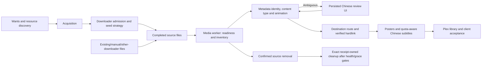

# Media Automation Product Delivery Plan

Status: current execution plan, 2026-10-24. This is the authoritative scope,
sequencing and acceptance summary. It supersedes contradictory scope, authorization,
phase and runtime-status statements in earlier integration/refinement plans. Detailed
module/spec contracts continue to apply. No production completion is claimed here.

Plan revision: `2026-10-24.r2`. The latest revision explicitly permits parallel
implementation under one integration owner and defers all naming work. Workers
must read this plan and state the revision they implement; a delivered message
alone is not evidence that its updated requirements were read.

## Product And Ownership

The product automates acquisition, seed strategy and media-library organization for
a personal NAS. It shares one repository, image, configuration authority and Web UI.
Domain execution, state, permissions and failure handling have explicit boundaries.

| Domain | Responsibility | Boundary |
| --- | --- | --- |
| Acquisition | Wants, discovery, release matching, candidate ranking and enqueue | Shared downloader admission, capacity/category authority and idempotency |
| Seed strategy | Upload decisions, managed torrent retention and bounded cleanup | Existing protective rules, durable audit and no expanded delete authority |
| Media library | Directory inventory, identification, routing, hardlinks and owned-output reconciliation | Independent worker clock and media SQLite; sources authoritative; no downloader dependency |
| Enrichment | Posters and multiple subtitle providers | Bounded jobs, provider-specific credentials/quota, common ownership/publication safeguards |
| Control plane | Configuration, Chinese review UI, command/status and evidence | Bounded persisted commands/read models; no inline provider/scanning work in seed/Web requests |

Acquisition and seed retain their tested runtime and shared downloader boundary.
Do not require a broad three-service rewrite, a broker or additional databases to
deliver Phase 1. Media uses its independent process/store and resource limits.

## Hardlink Mount Contract

Linux cannot create hardlinks across different mounts even when they reference the
same underlying filesystem. Therefore the working media deployment uses one common
read/write parent mount containing source and library paths. Separate source `:ro`
and target `:rw` binds, including nested overlays, must not be advertised as a working
hardlink topology. There is no copy/symlink fallback. Validate the actual mount layout
with a bounded synthetic Linux probe and the authorized production hardlink check.

Source bytes, names, permissions and deletion remain forbidden application actions.
A common read/write mount does not provide kernel-enforced source read-only access;
document that limitation rather than claiming stronger isolation. Config and narrow
provider secret mounts remain read-only, media state separately writable, and no
downloader secret or Docker socket is mounted in the worker. Do not add a publisher
service solely to conceal this deployment constraint.

## Phase 1 Production Configuration

Configure one source named Media for this deployment, with optional multiple disjoint
sources supported by the product. Do not infer type from the source directory name.
Library is the output parent, excluded before source traversal. Source bytes/names
remain unchanged; video publication creates verified hardlinks only.

| Confirmed content | Default destination | Plex library type |
| --- | --- | --- |
| Movie, including animated feature film | Movie | Movies |
| Non-animated series | TV | TV Shows |
| Animated series | Animation | TV Shows |

Use original metadata titles in paths and Chinese UI labels. TV has show/year/ID,
`Season NN` and episode naming. Keep optional separate animated-movie destinations;
the production default explicitly aliases animated movies to the Movie destination.
Preserve established runtime path spelling; private NAS paths stay in ignored config.
Existing owned outputs move only through reviewed stale-safe repair, not an implicit
default change. An OVA/theatrical filename token cannot override confirmed movie/TV
identity or resolved specials numbering.

Scan readiness comes from verified incomplete/completed publication or explicit manual
confirmation, not size stability alone. Exclude incomplete directories and current/
historical target subtrees. Unknown identity/classification, numbering, cuts, collisions
and EXDEV become persistent visible review/block states rather than guessed imports.

## Phase 1 Enrichment

- Integrate official TMDB metadata and posters. Reuse existing TMDB credentials and
  obtain IMDb identifiers through TMDB external IDs; no separate IMDb API is needed.
  Verify image content, normalize supported formats and retain provenance/receipts.
  Shared show posters survive until their final supporting source is removed.
- Integrate OpenSubtitles.com, ASSRT and SubDL behind common bounded orchestration.
  Their credential checks succeeded locally; this is not per-title corpus/payload or
  production acceptance. Traditional Shooter remains optional pending real hash-match
  and download evidence. Additional page-driven providers remain later work.
- Persist each provider's authentication, request pacing, account/IP/download quota,
  reset and retry state. Read actual API evidence, never hardcode plan allowances or
  local midnight. Exhausted providers pause independently while other providers work.
- First cover files lacking suitable Chinese subtitles; alternatives follow. Prefer
  Hans, then Hant, then explicitly configured provider-confirmed generic Chinese `zh`.
  Unknown script is displayed honestly; generic Chinese does not satisfy script-only
  profiles. Unknown language cannot become Chinese automatically.
- Identity/episode/cut/release/hash/FPS evidence outranks popularity. Preserve manual
  choices; reject unsupported packs or unresolved versions. Namespace candidate IDs
  and deduplicate verified payload content across websites. At most one new remote
  payload attempt per file per cycle; duplicates still consume that attempt.

## Current Evidence And Remaining Milestones

| Milestone | Current evidence | Remaining work |
| --- | --- | --- |
| Independent config/store | R0.1/R1 independently reviewed | Preserve these contracts in final integration |
| Worker/commands/quota | R2 plus quota correction independently reviewed | Multi-provider and role integration regression |
| Mixed sources/routing | Earlier mixed/health checkpoints independently reviewed; three-target alias, persistent Library exclusions and confirmed S00 integration pass locally | Final frozen integration review and deployed routing acceptance |
| Posters | Module plus guarded-preview/live-claim correction independently reviewed; 96 related checks passed; real local ARM TMDB payload evidence | Final integrated image, deployed lifecycle/coverage and actual library acceptance |
| New subtitle providers | ASSRT/SubDL real known-title Chinese payloads validated locally; multi-provider quota/fallback/dedup and language orchestration pass locally | Final independent integration review and deployed source matching/coverage acceptance |
| Deployment roles | R3 helper/entrypoint/templates independently reviewed; 45 related checks passed; shared glue integrated locally | Complete integration freeze, actual Linux mount tests and deployed role/resource/health acceptance |
| Acquisition/seed regression | Existing behavior retained | Prove relevant shared admission/race/idempotency guards; avoid unrelated rewrite |
| Release and full library | Authorized; final local integration independently reviewed: frozen 258 files verified, 1055 tests passed; local Linux common/split mount probes passed | Scoped feature release, CI/image verification, controlled rollout and actual inventory/import/client evidence |

Complete each remaining slice and return a frozen manifest, exact source snapshot,
requirement-to-test evidence and limitations for independent review. Supervisor review
is internal; the user does not need to approve routine implementation or every test.
Do not present an old checkpoint's test totals as validation of later changes.

## Release And Production Acceptance

The user explicitly authorized scoped commit/push, build/image publication, Unraid
deployment and real full-library organization/testing. Continue without requesting
the same permission again. Follow release-process versioning/hygiene and canonical
homelab-agent/DockerMan operation, backup, rollback and post-change verification.
Preserve unrelated worktree edits and existing seed/downloader behavior. Do not create
a second independently editable production config or infer approval for unrelated work.

Acceptance requires evidence from the deployed version:

1. Confirm immutable running image/config source/effective revisions, independent role
   liveness/state, mounts and actual filesystem hardlink compatibility. Record seed/qB
   pre/post health and configuration; fixture tests alone are insufficient.
2. Inventory the whole configured Media source with complete-scan evidence. Report
   source counts, resolved/unresolved identities, per-route imports, conflicts and
   completion blocks. Exercise movie, TV, animated movie and animated series routing.
3. Verify target structure and inode linkage, original source preservation and output
   exclusions. Validate unknown/manual asset protection, target outage/recovery and
   stale repair/provider/config/restore rejection. Cleanup remains receipt-scoped,
   complete-scan/grace-gated and non-recursive; source deletion is never authorized.
4. Report poster and subtitle coverage, actual downloads, provider failures/remaining
   quota/reset times and resumable waits. Quota waiting is not permanent failure or
   proof that all files received subtitles. Do not promise a fixed download count.
5. Verify Plex recognition, movie/TV library types and subtitle choice/playback with
   fresh server/client evidence where accessible. State any remaining physical-client
   check explicitly; healthchecks do not prove playback.

Full-library completion cannot be claimed while unresolved identities or blocked
outputs are omitted. Produce a durable review queue and precise counts rather than
force a match. Do not ask the user to approve records the system can safely resolve;
only material missing identity/intent or inaccessible external acceptance needs input.

## Phase 2

After Phase 1 delivery: additional providers, broader archive/absolute-numbering
support, subtitle synchronization/upgrades and evidence-led UX improvements. ASSRT,
SubDL, mixed sources, three production outputs and posters are Phase 1 requirements,
not deferrals. Keep quality replacement, auto-translation, broad media-server support
and major acquisition/seed runtime restructuring outside the current delivery unless
separately requested.

## Execution Coordination

The user authorizes assigning independent work to suitable sessions/agents. The
supervisor retains requirements, architecture, independent review and final release/
production acceptance decisions. The existing implementation session retains final
code integration; independent work uses explicit file ownership and preserves the
shared working tree. No duplicate deployment writer or competing config authority.

- Main integration: subtitle providers/orchestration/languages, destination defaults,
  shared config/CLI, runtime/worker integration and final regression/release preparation.
- Poster slice: `media_import/artwork.py` and `tests/test_media_artwork.py`; complete
  scheduler-facing lifecycle/status/health behavior, returning the exact integration
  interface rather than editing shared runtime/worker files.
- R3 slice: initially read-only role/mount/liveness investigation. Assign non-overlapping
  deployment/entrypoint/health files only after interfaces and ownership are agreed;
  shared config/CLI/runtime/worker edits remain with the main integrator.

Each slice reports plan revision, changed files, evidence and unresolved limits.
Final integration review binds exact source manifests and does not substitute a
worker's self-review for supervisor acceptance. Do not require additional user approval
for routine delegation or already-authorized implementation/deployment steps.

## Naming Deferred

The user explicitly postponed product and package naming. Keep existing project,
UI brand, CLI, `seed_agent` imports, image references, state/secrets paths and
DockerMan/container identities. Naming is not Phase 1 work and must not block it.
If revisited later, identity migration requires compatibility and rollback planning.

## Detailed Contracts

- `docs/specs/2026-10-23-execution-and-state-boundaries.md`
- `docs/specs/2026-10-24-media-source-routing.md`
- `docs/specs/2026-10-24-phase1-subtitle-providers.md`
- `docs/ai/modules/media-import.md`
- `docs/operations/media-import.md`
- `docs/operations/release-process.md`
