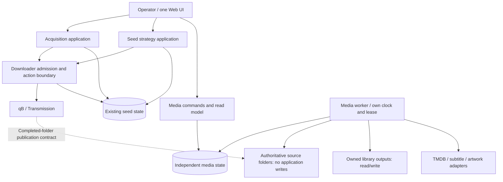

# Execution And State Boundaries

Status: authorized for incremental local implementation after user review, 2026-10-23.
This describes a target, not implemented or production-accepted behavior. It refines the integration
plan; preserve all reviewed local code and evidence during the transition.

## Diagnosis Before Decomposition

The problem is not the number of repositories or source directories. The local
implementation already separates many policies, but media work executes inline in
`schedule_run`; slow scans/metadata delay PT and the capacity guard. The HTTPError
containment patch fixes a known failure path, not latency or resource isolation.
A shared SQLite database and its restore/access locks also couple unrelated work.

Want acquisition and upload strategy have different goals, yet share an actual
resource: downloader capacity and mutation authority. Independently parallelizing
those callers without shared admission would create budget and duplicate-add races.
Media organization has a different authority: source folders and owned outputs. It
does not require a distributed transaction with torrent enqueue or Want lifecycle.

Therefore isolate media execution/state first; retain the existing, tested coupling
where it protects shared downloader invariants. Do not perform a three-way process
or directory rewrite simply to match three product labels.

## Recommended Topology

One repository, release/image, config schema and Web UI; independently runnable
roles. For this NAS, prefer two resource-limited containers using the same immutable
image: current seed runtime (including Web) and a media worker. A single-container
multi-process topology can be offered later but has weaker memory/CPU isolation and
requires explicit process supervision. Do not promise that both are equally safe.

The dotted handoff is filesystem publication, not a required hook or downloader
connection. Media work must remain usable with no downloader credentials or instance.

## Single Configuration Authority Across Runtime Roles

Two runtime instances must not maintain independent editable configuration copies.
Use one deployment-owned configuration directory shared by both roles. Web is the
normal configuration writer; worker mounts it read-only. Mount the directory, not
only an individual bind-mounted file, so atomic file replacement is visible in
both containers. An independently deployed worker must explicitly declare its
configuration source and identity; no fallback to a baked-in example file.

The shared YAML contains source/target mappings, readiness, naming, provider refs,
execute policies and intervals. Role selection and deployment limits are runtime
properties; do not duplicate business policies as Docker environment overrides.
Each role validates its common envelope and owned section and must not require the
other role's credentials, database or mounts. Keep secret reference paths in config,
but mount only role-required secret files into each instance. Sharing the entire
secret directory would undermine the worker's no-downloader-credentials boundary.

Configuration writes use existing revision/CAS and schema validation with atomic
replacement. SQLite stores observed applied revisions/commands, not a second mutable
source of desired config. Record and show:

- deployment/config source identity and full file revision,
- role's effective-section revision and last successful reload time,
- image digest/application/schema version and role identity,
- configured revision versus worker-applied revision and any validation error.

Full revisions detect different sources/stale reloads; effective-section revisions
avoid invalidating media work for an unrelated tracker edit. Derive revisions from
canonical validated config including secret references, never credential values.
A worker samples configuration at bounded intervals and before filesystem publication,
repair or unlink. Changed owned policy/roots/readiness/rendering invalidate pending
commands and claims; they must re-plan. A queued preview cannot gain execute authority
from a later config edit. A later restriction always wins. Invalid/missing worker
configuration stops media filesystem writes and exposes degradation; it cannot
silently keep destructive old policies. Seed continues under its own valid section.

Configuration drift is therefore detectable and bounded, not mathematically absent:
a worker may be unavailable or running an older image. On incompatible schema or
unacknowledged media revision, media execution fails closed and UI reports why;
seed does not wait for media acknowledgement. Do not require a distributed two-role
commit/barrier that recreates availability coupling. Version compatibility is explicit
and a simultaneous config update is not permission to restart either production role.

## Ownership And Permissions

| Responsibility | Authority | Must not own |
| --- | --- | --- |
| Acquisition | Wants, source identities, search evidence, selected release | Seed eviction policy, library deletion |
| Seed strategy | Mutable-category policy, upload scoring, retention decisions | Want terminal-state rewriting, library paths |
| Downloader actions | Fresh admission, reservations, idempotency, adapter calls, receipts | Metadata matching, library file operations |
| Media workflow | Source inventory, matching/review, link plans, owned-artifact reconciliation | Torrent delete/pause/add, source writes |
| Enrichment | Metadata, subtitles, artwork candidates and bounded download jobs | Inferring cleanup authority from filenames |
| Interfaces | Validate commands, persist decisions, return read models | Long scans/network work in request handling |
| Runtime | Leases, deadlines, scheduling, health and shutdown | Embedding domain policy in entrypoint/CLI |

Acquisition/strategy are application boundaries, not a mandate for new services.
Enrichment is a submodule of media, not a separate deployment. No additional HTTP
microservice, Redis, broker, distributed workflow engine or generic plugin platform
is needed for the present workload.

## Media State: Independent Because Its Lifecycle Is Independent

Target a separate media SQLite database on local appdata storage. Keep current seed
state and APIs unchanged. The Web uses a media-specific store/read model; missing or
broken media state produces a media warning and does not fail seed status endpoints.
No media migrations, restore or filesystem lease run on seed initialization paths.

Media worker is the only filesystem writer. Web/CLI persist bounded commands and
operator overrides to the media database; they never scan, call providers or link
inline. Use only short database transactions and explicit bounded lock waits. Reads
are read-only and snapshots are paginated. Database separation does not eliminate
host I/O contention; worker CPU, memory, scan and probe budgets remain mandatory.

No cross-database transaction: Want downloaded/viewed state and media imported state
are distinct. UI may join optional identities at read time, tolerating unavailable
or stale evidence. Never promote tracker identity into source-authoritative Want IDs.
Do not add direct SQL reads into the other domain's tables.

Migrate any existing locally generated media tables through an explicit consistent
snapshot/export/import with row counts, schema version, receipt verification and
idempotency. Retain original DB/audit; unknown legacy output ownership stays unowned.
Never silently initialize an empty media DB and conclude everything was removed.
Switch one media writer at a time. Do not assume local tables exist in production.

Media backups/restores fence only media work and invalidate its claims/config epoch.
Seed backup/restore must not acquire media filesystem locks once separation is live.
Pause/drain the media worker for media restore; keep API submissions visibly rejected
or queued under the new epoch. Restoring DB cannot undo already unlinked media files.
No global restore or startup schema rewrite across all domains.

## Media Scheduling: No Dependency On The Seed Clock

The media worker has its own due-profile clock. The seed scheduler must not submit
or await media scans, nor acquire media locks. A missed media tick should never
become a seed failure or delay the capacity guard.

The media command table is for explicit operator actions and retries, not a generic
business event bus. Coalesce routine scans per profile; distinguish scan, preview,
execute and exact repair commands. Do not silently turn preview into execute while
coalescing. Explicit commands include profile/config revision, source fingerprint,
plan revision, idempotency key and authorizing policy/decision. Stale commands must
re-plan rather than apply to new roots or editions.

Requests carry an execution mode fixed at submission. Current policy can restrict
it further, not escalate it. Exact destructive plans have an expiry and fresh
root/source/receipt checks. Worker unavailability is visible; there is no inline
fallback in Web or seed. Claim recovery is bounded and generation/token fenced.

Maintain independent video-import, enrichment and reconciliation statuses. Missing
or bad subtitles cannot block video import; a single partial publication cannot
halt the whole inventory. For safety, low-confidence identities/conflicts block
execution of their own files. Source deletion mirrors only receipt-owned artifacts
following complete healthy scans and grace; retain manual assets and shared references.

## Downloader Admission: Shared Safety, Not A Universal Job System

Keep all automatic and manual add/delete/pause actions behind the same application
boundary, preserving category authority, add-only media pools, billing-risk and hard
capacity rules. Strategy and acquisition can prepare search/decision data separately.
Their mutation phase must re-read relevant live state and coordinate projections.

Before introducing independent acquisition/seed workers, prove process-wide
reservations/claims, single authority per operation, and recovery for ambiguous
network outcomes. Never release a reservation and blindly re-add because an API
response timed out after acceptance. Preserve exact selected category/hash evidence.
Do not hold SQLite transactions across downloader/tracker network calls.

The gateway is a module initially, not a mandatory extra daemon. Document and enforce
its concurrency contract before expanding parallelism. Shared tracker credentials
also require request-level pacing/backoff across any new processes; current
per-process pacing must not be mistaken for account-wide protection.

## Health And Resource Contracts

- Seed health: lease, heartbeat, successful/failed cycle and capacity guard age.
- Media health: worker heartbeat, last full scan, queue age, progress and conflicts.
- Providers: missing credentials vs quota/backoff vs no results vs unsafe match.
- Container process alive alone is not domain health; media failure must remain
  visible without misreporting seed failure or declaring the whole product healthy.
- Declare a maximum media work slice and memory/CPU/pids/probe limits. Inventory
  enumeration stages bounded batches; only a complete generation can authorize
  missing-source decisions. Do not commit one unbounded library-wide transaction.
- Seed capacity guard's deadline must be tested while media is slow or stuck. A
  renewing scheduler lease is not proof the guard ran. Initial media separation
  fixes media-induced delay only, not every pre-existing tracker/seed delay.

## Current Behavior Versus Target

| Area | Reviewed local behavior | Recommended target |
| --- | --- | --- |
| Media trigger | Inline seed cycle and synchronous Web/CLI | Independent worker clock; queued interface commands |
| Media state | Shared StateStore tables/restore lock | Independent media database/store/restore epoch |
| Failures | Expected HTTP errors contained | Process/resource/state boundaries plus visible domain health |
| Metadata/subtitles | Domain submodules with durable job receipts | Preserve and reuse, not rewrite |
| Artwork | Existing per-file JPEG/PNG reuse | Separate bounded remote-artwork capability if later selected |
| Downloader | Shared enqueue path, policy gates | Preserve and formalize admission before parallel callers |
| Naming | Original metadata title; Chinese UI; Plex-first | Preserve, with server-specific rendering adapters |

Remote poster fetching is a product capability gap, not something architecture
refactoring magically supplies. Do not hide it in infrastructure work or claim it
is delivered by the existing local-artwork path.

## Self-Refinement Audit

| Rejected simplification | Refined decision |
| --- | --- |
| Three domains require three repos/services | One codebase; separate execution only where measured coupling warrants it |
| Separate worker but seed must enqueue its scan | Worker owns its clock; seed never depends on media availability |
| Two containers guarantee identical config | One shared config authority, per-role revisions, narrow secret mounts and fail-closed writes |
| Different processes fully isolate a shared SQLite DB | Separate media state and restore boundary; still bound host resources |
| Independent seed/acquisition workers can call qB freely | First enforce shared admission/reservations and ambiguity recovery |
| One container is always the simplest safe deployment | Same image, separate resource-limited roles preferred on NAS |
| Periodic scan of a whole tree is harmless | Bound read I/O, stage generations and fail closed on incomplete scans |
| User review is a mutable pending flag | Exact versioned command/preview contracts, stale rejection and audit |
| Tests passing means production is safe | Concurrency/deadline/host/client acceptance remains explicit |

## Non-Goals And Next Gate

Do not rename every package or split the shared state model wholesale. Do not
reimplement stable tracker/parser logic. Do not add cross-seeding automation (the
current seed lane is upload-farming/retention, not proof of matching torrents across
sites). Do not upgrade production while execution isolation is still a proposal.

Use the matching refinement plan for ordering and acceptance. This specification
requires independent review at each implementation milestone. The user has now
authorized proceeding in the existing coder session; this does not authorize a
production upgrade or bypass the concrete controlled NAS acceptance plan gate.
