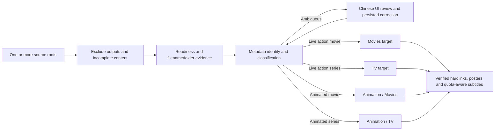

# Mixed Source Libraries And Metadata Routing

Status: user-authorized Phase 1 refinement, 2026-10-24. Proposed contract; the
current implementation still binds a source profile to one type and target.
This supersedes that binding for new mixed-source configuration. Existing naming,
readiness, original-title, Chinese-UI, ownership and source-removal rules remain.

## Latest Production Default (2026-10-24)

The user explicitly directs continued implementation, release and production
acceptance without another approval round. Configure one source named Media for
the current deployment; keep multi-source capability available. Library is the
output parent and an excluded source subtree, not a fourth content category.
Preserve the actual established path spelling from ignored runtime configuration.

Default routes for this deployment:

- All movie content, including animated feature films/theatrical releases, goes
  to the Movie destination and a Plex Movies library.
- Non-animated episodic content goes to TV and a Plex TV Shows library.
- Animated episodic content goes to Animation and a separate Plex TV Shows library.
  A separate animation library is the user's organization preference; Plex's
  requirement concerns matching the movie/TV library type, not a special anime type.

This default supersedes the separate animated-movie output shown below. Retain
optional separate animated-movie destinations for future configuration. Two routes
with the same movie content type may explicitly share the identical destination
and naming/marker policy; do not allow unrelated overlapping movie/TV roots. An
animated flag remains metadata, not a separate content type. Do not create a duplicate
hardlink in both Movie and Animation for an animated film. A title token such as
theatrical/OVA does not override the confirmed metadata movie/TV identity or resolved
specials numbering.

Update config validation, source exclusion, historical receipt handling, UI routing
and shared-reference tests to support this three-destination default before final
release. Existing explicit separate destinations must retain their behavior. No
silent movement of already-owned output follows a default/config change; use the
existing reviewed repair and historical-root protections.

## Configuration And Responsibilities

- Configure one or more recursive source roots, independently of output libraries.
  Each stable source ID owns mount markers, readiness, exclusions and scan history.
  A source directory name never establishes a media type.
- Configure output destinations for movies, TV and animation. Animation may have
  one configured base with separate `Movies` and `TV` children, or two explicit
  roots. These are distinct Plex movie/TV library locations, not one mixed Plex
  library. Output destinations own root health and naming rules.
- Classification has two independent dimensions: content type (`movie` or `tv`)
  and animation evidence. Animation defaults to all animated content, not only
  Japanese anime. Routing follows confirmed metadata plus persisted operator
  overrides. Animated movies keep movie naming/API identity; animated series keep
  season/episode naming/API identity. Never overload `anime` to mean TV.
- Keep existing source profiles usable through an explicit compatibility adapter;
  preserve source generations, receipts and review history. Do not silently
  reinterpret legacy classification, rename IDs or re-import existing outputs.
  The final YAML shape belongs to implementation review rather than this proposal.

## Identification And Routing

1. Traverse allowed source paths; record stable source ID, relative path and
   fingerprint. Apply the existing downloader-independent completion contract.
2. Parse filename and parent release-folder title, year and season/episode hints.
   Missing episode syntax does not prove a movie. Directory names are hints only.
3. Search appropriate movie/TV metadata candidates. Preserve identity/type evidence,
   genre/animation evidence and ambiguity; use bounded requests/cache/batches.
   Do not classify from a filename substring, duration, country or language alone.
4. Confirm work identity, content type and animation classification. If movie and TV
   are ambiguous, numbering is unresolved, or classification evidence is missing,
   expose review candidates and a reason; do not default to a destination.
5. Choose the configured route, render the existing canonical naming scheme and
   preview the output path. A missing/unhealthy destination blocks that publication
   without authorizing writes elsewhere.
6. Publish verified hardlinks and owned enrichment. Persist the effective route,
   target identity and route/config revision with each plan/publication/receipt.
   Subtitle and poster APIs use content type, not the output library label.

## Source Authority And Path Safety

A source root may contain a configured output subtree, for example a broad media
root with a library child. Exclude every configured output subtree by canonical
path before descent; never scan generated links, subtitles or posters as inputs.
Validate these exclusions on every scan/config reload. A target equal to or above
a source remains invalid. Reject overlapping source roots initially, with a clear
configuration error, so one file cannot acquire conflicting deletion authority.
Retain symlink, root-marker, inode, complete-scan and outage protections. Existing
incomplete exclusions/readiness remain necessary under a broad source root.

Removal is determined only by complete healthy observations of the owning source,
never by target existence or classification success. Unknown metadata is not source
removal. Cleanup/repair must validate the receipt's historical target root and route,
not infer them from the source's current route. Classification or destination changes
require preview and stale-safe repair: verify new outputs before retiring exact owned
old outputs. Shared references and manual assets remain protected. A route/config
change fences queued commands, subtitle/poster responses and publication recovery.

## UI And Acceptance

Show source path, movie/TV identity, animation classification, classification evidence,
destination, planned path and review reason. Permit persistent manual identity/type/
animation corrections and show the resulting route before apply. Keep classification
and download completion confirmation separate.

Required cases before production rollout:

- One mixed source containing a movie, series, animated movie and animated series
  routes correctly, including misleading parent names and files without clear tokens.
- Multiple disjoint sources share destinations without losing independent source
  authority; overlapping source configuration is rejected.
- Output nested inside source is never re-ingested, including after restart and
  output-root changes; incomplete files and failed scans cannot authorize removal.
- Ambiguous identity/type and unresolved animation/episode mapping remain review items;
  a manual correction persists across scans and stale responses cannot reverse it.
- Animated movie subtitles/posters use movie APIs; animated series use TV APIs.
- Destination changes, collisions, EXDEV, offline roots, source deletion and shared
  artwork preserve exact receipts, original files and unrelated/manual outputs.
- Legacy profile/state migration preserves history and ownership; seed regression,
  bounded-worker, queue, quota and restore fencing checks remain valid.

References: [Plex naming and organization](https://support.plex.tv/articles/naming-and-organizing-your-tv-show-files/),
[Plex library types](https://support.plex.tv/articles/200288926-creating-libraries/).
